# 电芯UWB星型组网的300节点数据收集实验

目标是在100 ms内完成一轮300节点数据收集。实体板轮流发送32 bit测试数据，模拟300个电芯节点。

**耗时折算**采用Δt₁＝Δt₅＝300 μs。原始整轮测试设为400 μs，每发一次调度广播或批量补发广播，扣除0.10 ms。收包数和补发次数取实测记录，逐条请求补发的回复等待仍为200 μs。

## 1 帧间隔取多少合适

- **帧间隔可压至0 μs，从10 μs缩至5或0 μs时，漏收增加，补发多花的时间超过了缩短间隔省下的时间。**

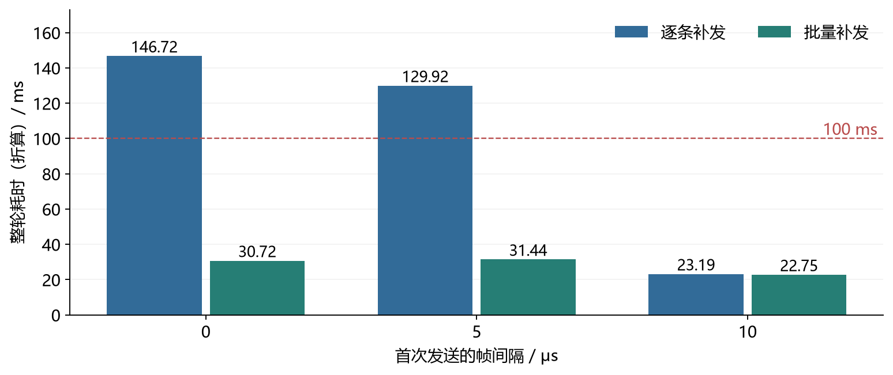

图1. 8块叶节点板轮流发送300条数据，比较逐条补发和批量补发的整轮平均耗时（折算）。0和10 μs各测33轮，5 μs测99轮。

## 2 一帧需要发多久

- **相邻节点的发包起始间隔等于单帧时长加帧间隔，单帧缩至55.706 μs后，每隔65.706 μs就能安排一个节点发送。**

数据帧从272 bit缩至48 bit。测试程序按已知顺序发送，去掉了152 bit实验管理字段和72 bit帧控制与地址字段，只发送32 bit电芯测试数据和16 bit校验。

固定48 bit数据帧及高速物理层帧头，将前导码从128个符号缩至32个符号，单帧计算时长从153.398 μs降至55.706 μs，节省97.692 μs。再加上选定的10 μs帧间隔，就得到一个节点的时槽长度。

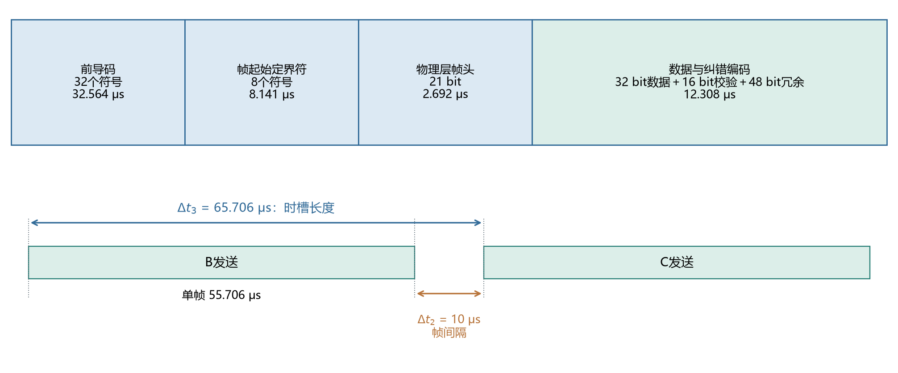

图2. 上图为一帧的组成，下图为两个节点相继发送的时序。采用信道5、6.8 Mbps，单帧时长按芯片规格计算。[DW3000规格](https://www.mouser.com/catalog/specsheets/qorvo_dw3000.pdf)

## 3 同一组叶节点每轮发送7条和300条数据

- **每块叶节点板各发1条时，174/200轮一次广播就收到全部7条。用同一组板轮流发送300条时，每轮都用到了补发，仍有200/200轮在100 ms内完成。**

两组共用1块中心节点板和7块叶节点板。每帧含32 bit电芯测试数据和16 bit校验，前导码长度32个符号，帧间隔10 μs。中心节点在首批发送结束后统一通知缺包节点补发。

| 每轮数据条数 | 整轮平均耗时（折算） | 整轮最大耗时（折算） | 100 ms内完成的轮数 |
| ---: | ---: | ---: | ---: |
| 7 | 2.17 ms | 4.15 ms | 200/200 |
| 300 | 24.86 ms | 36.09 ms | 200/200 |

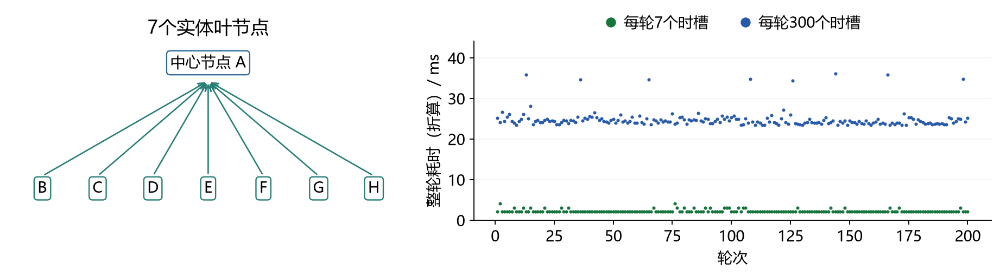

图3. 每个点代表一轮，从计划开始计至中心节点完成缺包检查和补发。中心节点的主控nRF52832通过串行外设接口（Serial Peripheral Interface，SPI）读写UWB芯片，接口时钟为8 MHz。

## 4 一次广播安排300个时槽

- **中心节点广播一次，8块叶节点板轮流发送300条数据，最后一个时槽在广播后约20 ms。**

### 4.1 每轮怎样同步，轮末误差有多大

- **等待约20 ms后，频偏补偿使数据帧到达中心节点的平均绝对误差从40.03 ns降至4.73 ns，补偿后的最大误差约为0.014 μs，远小于10 μs的帧间隔。**

每轮收到中心节点的广播，各叶节点就从这一刻开始计时。各板的晶振有快慢，叶节点用同一帧广播估计自己的时钟比中心节点快多少或慢多少。按这个差值，把原本会早发的时刻往后调，晚发的往前调，就是频偏补偿。

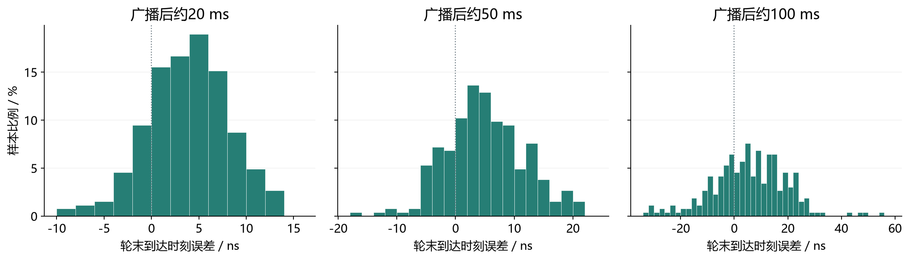

图4. 开启频偏补偿时，广播后约20、50、100 ms处的数据帧到达误差。每档8块叶节点板各测33轮，负值为早到，正值为晚到。中心节点采用nRF52840，SPI为16 MHz。

### 4.2 每次广播安排多少个节点

- **比较每次广播安排20、30、50和300个节点的方案，一次安排300个时槽、随后批量补发的整轮平均耗时最短，为22.75 ms。**

节点按顺序发送，下一个节点无需等待中心节点确认上一帧。中心节点检查本批缺少哪些数据，再用一次广播通知对应节点补发。每条缺失数据最多补发4次。

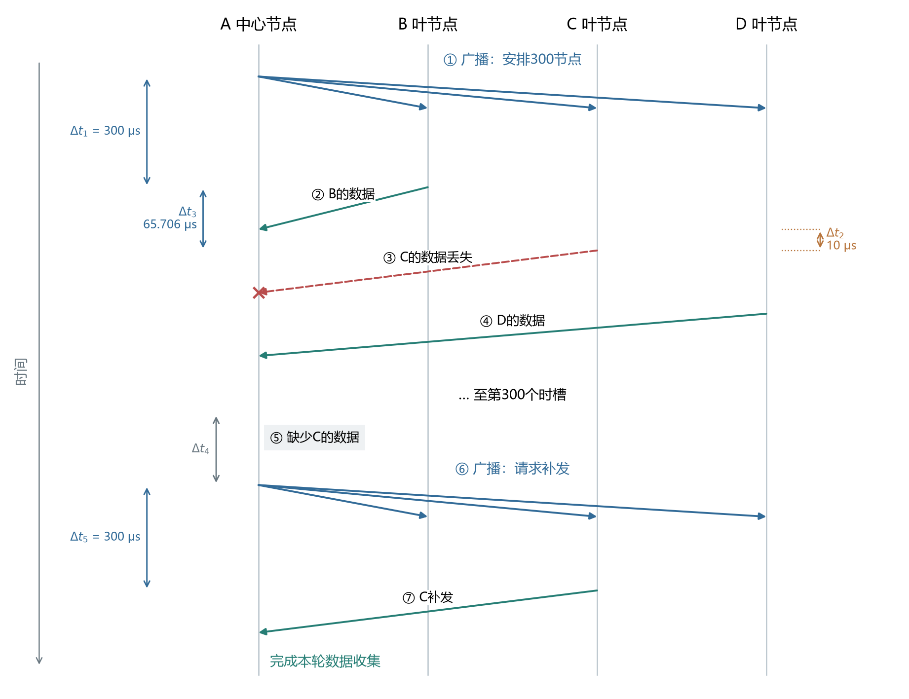

图5. Δt₁为调度广播至首条数据的间隔，Δt₅为补发广播至首条补发数据的间隔。Δt₂为帧间隔，Δt₃为相邻两帧的起始间隔，Δt₄为缺包检查及补发准备时间。

每批20个节点时，安排300个节点首次发送需要15次广播，整轮平均34.62 ms。一次安排全部300个节点时，首次发送只需1次广播，后续广播只用于补发。

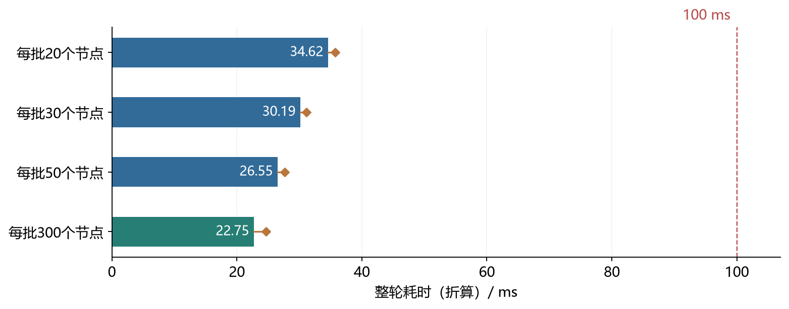

图6. 四种分批方式下完成一轮300节点数据收集的耗时，各测33轮。柱为平均值，菱形为最大值。

**自然漏收时，每轮300条中平均只缺一两条，批量补发能省下的请求很少。** 逐条补发和批量补发各测33轮。两组每轮首次平均缺1.79和1.30条，中心节点平均发出1.79和0.82次补发请求，整轮平均耗时折算后相差0.43 ms。

人为让部分数据首次漏发后，两组每轮都缺约30条。逐条补发平均需要30次请求，批量补发只需1.15次，整轮平均耗时分别为47.27和26.06 ms（折算）。

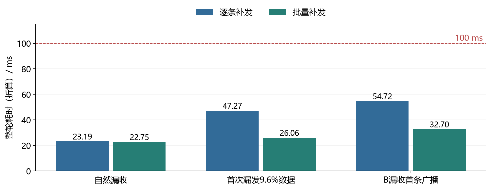

图7. 自然漏收、首次漏发部分数据和一个叶节点忽略首次广播三组对照。采用批量补发时，每组33轮均在100 ms内完成。

## 5 补充实验

采用一次广播安排300个时槽、缺包批量补发的方案，检验连续运行和节点漏发时的整轮接收情况。1块中心节点板和7块叶节点板模拟300节点，中心节点采用nRF52832、SPI 8 MHz。每100 ms开始一轮，帧间隔10 μs。以下按Δt₁＝Δt₅＝300 μs折算耗时，沿用每轮实测的广播次数和接收结果。

### 5.1 连续运行

- **连续实测10,000轮，每轮均在100 ms内完成。** 首次发送300条后，中心节点每轮缺3～63条，平均缺14.86条。4,869轮在第一次补发后仍缺数据。

完成一轮300节点数据收集的折算耗时平均为26.07 ms，最大为37.32 ms。原实测平均为26.32 ms，最大为37.72 ms。

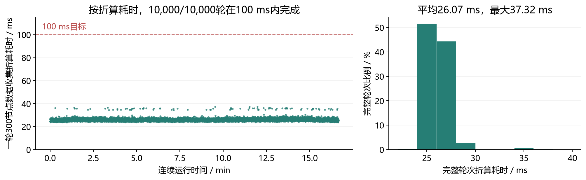

图8. 连续16.67 min内各轮的折算耗时，从计划开始到缺包检查结束，含补发。右图分箱2 ms。

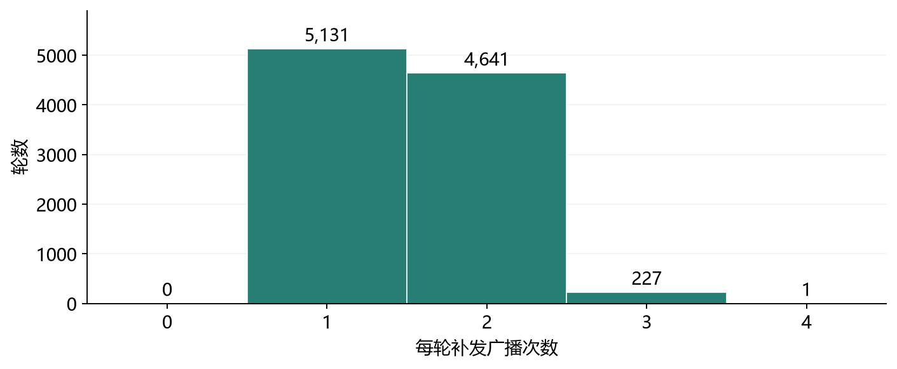

图9. 每轮补发广播次数的实测分布，首次广播不计入。每次补发广播可请求多条缺失数据。柱上数字为对应轮数。

### 5.2 连续漏接广播

- **一个叶节点连续漏接广播会错过自己的发送时槽，实测批量重传均能补齐缺包。**

软件控制B板每轮忽略前1、2或3次广播，收到后续广播时再发送。三组各测100轮，每轮均在100 ms内完成，三组中最大的折算耗时为60.69 ms。

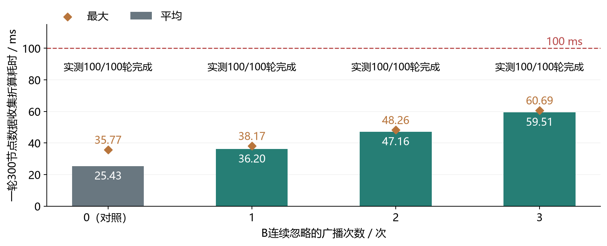

图10. B板连续忽略0、1、2或3次广播时的整轮折算耗时。0次为同一组板卡正常回复的对照。

### 5.3 连续漏发后恢复

- **一个叶节点连续停发时，中心节点缺少它负责的数据，3次试验均在恢复发送后的第一轮收到当轮全部300条。**

B板每轮负责42或43条数据。让B板连续10轮不回复再恢复，重复3次。暂停期间，中心节点每轮收到256～258条，其他6个节点合计另缺2条。其余69轮均收到全部300条，折算耗时平均为25.83 ms，最大为34.66 ms。

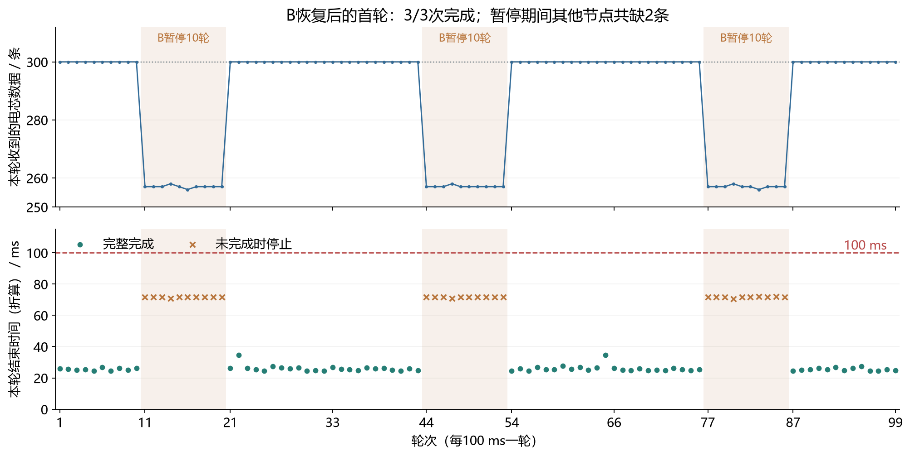

图11. 上图为中心节点实测收到的数据条数，阴影表示B板暂停发送。下图为各轮折算结束时间，橙色叉号表示未完成轮次停止补发的时刻（70.67～72.01 ms）。
