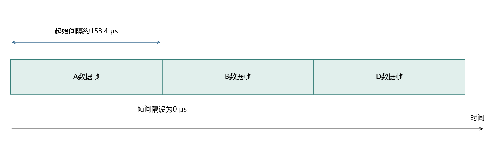
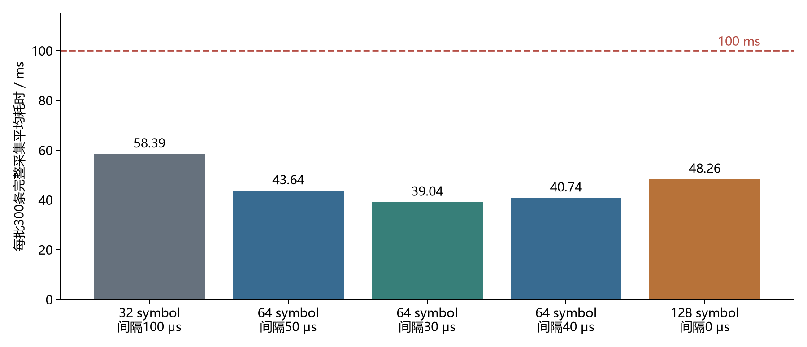

# 四板星型广播：最短帧间隔与完整采集实测

- **帧间隔参数已压到0 μs。** 48 bit自定义数据帧、前导码长度128 symbol、高速物理层帧头条件下，10000条首次全部收到，无需补发。
- **包含补发后，当前正式测试中最快的是前导码长度64 symbol、帧间隔30 μs。** 首次接收率99.70%，最终10000／10000；每批300条完整采集平均39.039 ms，最大43.792 ms。
- **上述300条由三个实体发送节点重复承担时槽。** 本实验验证四板上的排程时间预算与连续收包，硬件规模为一个中心、三个叶节点。

## 1 实验目标与实现

**直接测量中心连续接收不同叶节点数据时所需的帧间隔。** 使用一次广播安排一批数据，叶节点按时槽发送，中心按收到的测试数据统计缺失，并对缺失项单独请求补发。

| 项目 | 本次设置 |
|---|---|
| 实体板分工 | C板为中心（nRF52840）；A、B、D为叶节点（两块nRF52832、一块nRF52840） |
| 组网形式 | 星型拓扑广播，一个中心直接接收三个叶节点的数据 |
| 虚拟排程 | 每批300条，三个叶节点轮流承担100个时槽；正式测试10000条，包含33批300条及末批100条 |
| 数据帧 | 32 bit确定性测试内容＋16 bit硬件校验，共48 bit；无标准地址帧头、无152 bit实验管理字段 |
| 测试内容 | 由样本编号生成32 bit测试值，用于逐条校验和统计；模拟电芯上报数据 |
| 信道与速率 | 信道5、6.8 Mbps；Qorvo 8 symbol定界符；高速物理层帧头；安全时间戳序列关闭 |
| 前导码对照 | 32、64、128 symbol |
| 接收路径 | SPI使用DMA；开启双接收缓冲，先重开接收，再读取上一包；按缓冲区CRC成功标志读取数据 |
| SPI时钟 | 正式结果均为8 MHz，C、D板使用SPIM3，A、B板使用SPIM0 |
| 首次回复安排 | 每批广播接收时间戳后1000 μs安排首个数据时间戳，随后按时槽依次发送 |
| 批尾等待 | 中心按本批计划结束时间额外等待500 μs，再检查缺失项 |
| 补发 | 每条缺失数据最多再请求4次，回复帧间等待设置500 μs；补发耗时计入完整采集时间 |
| 参数来源 | 前导码档位、硬件定时发送和双缓冲由芯片支持；时槽、批大小和上述等待由本测试程序设置 |

首次回复安排与批尾等待保留在总计时中。三块叶节点的时槽映射及配置通过调试接口预先设置；广播携带本批起始样本编号。真实电芯数据的动态时槽分配、节点加入和配置下发仍需单独实现和计时。

## 2 零帧间隔：数据帧基本首尾相接

**128 symbol前导码下，标称帧间隔0 μs完成了10000条首次接收。**

图1. 48 bit数据帧、前导码长度128 symbol、高速物理层帧头下的连续发送示意。每个数据帧计算发送时间约153.398 μs，时槽按相同长度设置，额外帧间隔为0 μs。A、B、D为三个不同叶节点，图中宽度按时间比例绘制；帧内前导码等字段未展开。

中心在每批开始附近采样连续接收硬件时间戳，观察到的相邻时间戳间隔为153.383～153.412 μs。与153.398 μs计算帧时长相差约±0.02 μs，说明相邻数据帧基本首尾相接。采样覆盖每批开始附近的连续数据，额外间隔0 μs为程序设定值；各节点时钟、路径和时间戳误差仍反映在实测间隔中。

| 零帧间隔正式测试 | 实测结果 |
|---|---:|
| 首次收到／应收 | 10000／10000 |
| 补发次数 | 0 |
| 最终收到／应收 | 10000／10000 |
| 300条完整批次数 | 33 |
| 每批300条平均完整耗时 | 48.259 ms |
| 每批300条最大完整耗时 | 48.260 ms |
| 100 ms内收齐的完整批次 | 33／33 |

## 3 最短间隔与最快采集分别比较

**64 symbol前导码、30 μs帧间隔的完整采集更快。** 128 symbol前导码支持零额外间隔，其前导码本身占用更多时间；32 symbol前导码配过短间隔会产生大量缺失和补发。

图2. 每批300条虚拟上报数据的完整采集实测平均值，每个配置正式测试10000条，图中使用其中33个完整300条批次。计时从中心准备广播开始，到本批数据接收和缺包补发结束；包含广播、首节点安排、批尾等待、处理及补发。虚线为100 ms目标。

| 前导码长度 | 帧间隔设置（μs） | 单帧时长：计算（μs） | 首次接收率：实测 | 最终收到／应收：实测 | 300条平均／最大耗时：实测（ms） | 100 ms内收齐批次 |
|---:|---:|---:|---:|---:|---:|---:|
| 32 symbol | 0 | 55.706 | 34.04% | 10000／10000 | 320.083／370.131 | 0／33 |
| 32 symbol | 100 | 55.706 | 97.96% | 10000／10000 | 58.388／203.457 | 32／33 |
| 32 symbol | 200 | 55.706 | 98.75% | 10000／10000 | 84.564／234.940 | 32／33 |
| 64 symbol | 0 | 88.270 | 53.59% | 10000／10000 | 242.758／268.528 | 0／33 |
| 64 symbol | 5 | 88.270 | 69.30% | 10000／10000 | 171.891／193.136 | 0／33 |
| 64 symbol | 50 | 88.270 | 100.00% | 10000／10000 | 43.638／43.638 | 33／33 |
| 64 symbol | 30 | 88.270 | 99.70% | 10000／10000 | 39.039／43.792 | 33／33 |
| 64 symbol | 40 | 88.270 | 99.98% | 10000／10000 | 40.737／43.724 | 33／33 |
| 128 symbol | 0 | 153.398 | 100.00% | 10000／10000 | 48.259／48.260 | 33／33 |

表中最终接收率为本次测试观察结果；批次耗时包含实际发生的补发。不同配置按顺序测试，当前结果用于选择后续复测候选。

## 4 200～300节点与100 ms目标

**300条虚拟上报已在四板实验中完成整批计时。** 最快正式配置的33个300条批次均在100 ms内收齐；零帧间隔配置的33个300条批次也均在100 ms内收齐。

| 配置 | 200条时间：线性推算（ms） | 300条时间：批次实测平均（ms） | 300条时间：批次实测最大（ms） |
|---|---:|---:|---:|
| 64 symbol，30 μs间隔 | 26.045 | 39.039 | 43.792 |
| 128 symbol，0 μs间隔 | 32.202 | 48.259 | 48.260 |

200条按正式10000条测试的平均每条耗时线性推算；300条列实际完整批次计时。实体300节点的空间信道、独立时钟分布和动态配置开销需要在扩大硬件规模后测量。

## 5 结论

- **此前约350 μs帧间隔不是本次硬件能达到的最短设置。** 改善接收路径后，已完成零额外帧间隔的四板正式测试。
- **当前目标应使用完整采集耗时选参数。** 本轮最快候选为64 symbol前导码、30 μs帧间隔；128 symbol、0 μs用于证明可以基本首尾相接。
- **48 bit帧、DMA和双缓冲接收已接入实际星型广播。** 最终数据逐条校验，缺失数据按请求补发，报告保留首次接收和最终接收两项统计。

数据：[正式测试记录](正式测试记录.jsonl)；代码和固件：[本次代码与固件（已拆分归档）](../../../code/README.md)。四块板原固件及UICR均已备份，测试结束后已停止收发。
