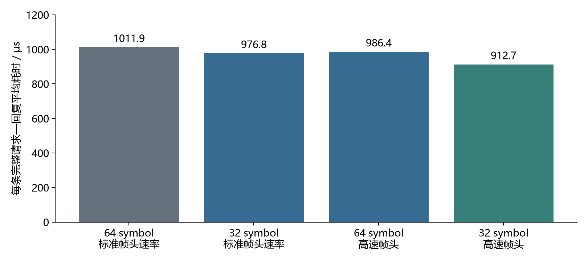

# 48 bit精简帧实测：前导码、物理层帧头与回复等待

- **48 bit帧已在A、B两板完成收发及重传测试。** 每个请求和回复均为32 bit测试内容＋16 bit芯片校验；标准地址帧头和152 bit实验管理字段均已删除。
- **精简配置配合350 μs回复等待，完整请求—回复平均耗时为778.8 μs。** 相比本次48 bit帧、64 symbol前导码、标准速率帧头、500 μs等待对照，减少23.0%。
- **以上为两板逐条轮询实验。** 多节点按时槽识别来源及采集轮次的协议尚未实现；本次使用可核验的32 bit测试数据验证传输与重传。

## 1 实验设置与帧结构

| 参数 | 设置与来源 |
|---|---|
| 硬件 | A、B均为nRF52832主控＋DWM3000EVB；先备份原固件，再烧录独立测试程序 |
| 信道与数据速率 | 信道5、6.8 Mbps；射频功率寄存器设置保持相同 |
| 数据帧 | 32 bit测试数据＋16 bit硬件校验，共48 bit；芯片帧长寄存器设置为6字节 |
| 帧头与地址 | 关闭标准MAC地址过滤；应用不写入标准地址帧头 |
| 测试数据 | 请求携带数据索引；回复携带由索引生成的32 bit确定性测试值，中心逐条核验。数据内容本身用于查错和丢失统计，未另外添加序号字段 |
| 前导码 | 对照64、32 symbol；定界符均为Qorvo 8 symbol |
| 物理层帧头 | 对照标准速率与数据速率；两者均由芯片生成21 symbol帧头 |
| 测试规模 | 每个正式配置10000条数据；等待扫描每档300条 |
| 重传 | 每条最多尝试5次；请求后未收到正确回复则再次请求相同数据 |
| 回复等待 | 以请求帧结束至回复帧开始为目标设置；利用硬件时间戳、厂家帧时序计算和定时发送实现 |
| 主控时钟与触发 | 使用原主控SPI驱动与DW3000定时发送；本实验未加入PPI或DMA优化 |

48 bit长度包含校验。前导码、定界符、物理层帧头和纠错冗余另计。按厂家时序计算，64 symbol＋标准速率帧头时单帧约107.116 μs；32 symbol＋高速帧头时约55.706 μs。两者均保留48 bit纠错冗余。这些单帧时长属于计算值。[厂家时序依据](https://www.mouser.com/catalog/specsheets/Qorvo_DW3000.pdf)。

## 2 相同回复等待下的物理层对照

**32 symbol前导码＋高速物理层帧头，在本次500 μs等待对照中耗时最短。**

四组均为A请求、B回复，回复等待500 μs。完整计时从中心准备请求开始，到对应数据正确收到或五次尝试结束；包含请求、回复、主控处理、等待、超时和重传。每条平均耗时由全部10000条的计时总和计算；整组耗时另含循环开销。

图1. 48 bit帧的四组物理层实测对照，每组10000条；纵轴包含请求、回复、程序处理、等待及重传。各组回复等待均为500 μs。

| 配置 | 首次请求成功率 | 最终收到／应收 | 重试请求次数 | 整组耗时（s） | 每条平均耗时（μs） |
|---|---:|---:|---:|---:|---:|
| 前导码64 symbol，标准速率帧头 | 99.94% | 10000／10000 | 6 | 10.134 | 1011.9 |
| 前导码32 symbol，标准速率帧头 | 98.11% | 10000／10000 | 189 | 9.782 | 976.8 |
| 前导码64 symbol，高速帧头 | 99.93% | 10000／10000 | 7 | 9.878 | 986.4 |
| 前导码32 symbol，高速帧头 | 99.69% | 10000／10000 | 31 | 9.141 | 912.7 |

## 3 缩短回复等待

**当前程序在50～200 μs目标等待下无法及时启动定时发送；350 μs通过了后续正式测试。** 延迟启动失败表示主控完成接收解析、写入数据和设置发送时间后，已经错过预约发送时刻；这反映当前程序与SPI路径的准备耗时。

| 目标回复等待（μs） | 收到／应收 | 首次请求成功率 | 回复端错过发送时刻次数 |
|---:|---:|---:|---:|
| 50 | 0／300 | 0.00% | 1322 |
| 100 | 0／300 | 0.00% | 1496 |
| 150 | 0／300 | 0.00% | 1264 |
| 200 | 0／300 | 0.00% | 1497 |
| 300 | 222／300 | 26.33% | 774 |
| 350 | 300／300 | 100.00% | 0 |
| 400 | 300／300 | 100.00% | 0 |
| 450 | 300／300 | 89.33% | 0 |

扫描用于选择正式测试候选；正式测试结果如下。反向组改为B请求、A回复；人为丢包组在回复端每十条数据丢弃一次首个回复，重试时正常发送。

| 配置 | 首次请求成功率 | 最终收到／应收 | 重试请求次数 | 整组耗时（s） | 每条平均耗时（μs） |
|---|---:|---:|---:|---:|---:|
| 精简配置、自然丢包 | 99.68% | 10000／10000 | 32 | 7.802 | 778.8 |
| 精简配置、反向传输 | 98.71% | 10000／10000 | 129 | 8.017 | 800.3 |
| 精简配置、10%首次回复人为丢弃 | 89.60% | 10000／10000 | 1051 | 10.072 | 1005.7 |

人为丢弃的首次回复共1000次，最终收到10000／10000条。

## 4 100 ms预算与200～300节点推算

**使用实测逐条轮询耗时推算容量，包含请求与重传。** 每个节点每轮回复32 bit数据，各节点依次执行相同请求—回复流程：100 ms容量＝floor(100000／每条平均耗时)，200或300节点时间＝节点数×每条平均耗时。以下全部为两板结果的时间外推。

| 设置 | 每条平均耗时：实测（μs） | 100 ms节点数：推算 | 200节点耗时：推算（ms） | 300节点耗时：推算（ms） |
|---|---:|---:|---:|---:|
| 48 bit帧对照：64 symbol、标准速率、500 μs等待 | 1011.9 | 98 | 202.4 | 303.6 |
| 精简配置、较短等待 | 778.8 | 128 | 155.8 | 233.6 |
| 精简配置、10%人为漏发 | 1005.7 | 99 | 201.1 | 301.7 |

实际硬件规模为两个节点。广播一次、多个叶节点分时回复可减少逐节点请求，其容量需用相应多节点协议实测更新。

## 5 结论

- **48 bit自定义帧已通过两板收发测试，缺包可由重复请求补发。** 删除额外字段后，校验和确定性测试内容仍用于核验数据。
- **缩短无线帧与缩短主控准备时间需要分别评价。** 约55.7 μs是单帧物理层计算发送时长，完整请求—回复实测还包含主控处理及等待。
- **下一步将精简数据帧接入星型拓扑广播调度。** 需实现按时槽识别来源、限定补发窗口和区分采集轮次，再测收齐299个叶节点的时间预算。

原始逐组记录见[results.jsonl](results.jsonl)，原固件及UICR备份保存在本目录；本次固件和源代码见[source-and-firmware.zip（已拆分归档）](../../../code/README.md)。
