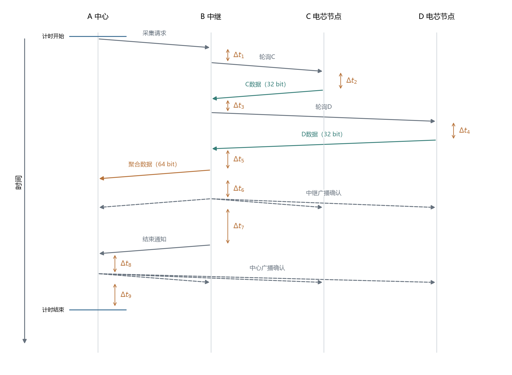

# 树型拓扑两跳中继：聚合转发与回复延迟实验

## 实验参数设置

| 参数 | 设置 |
|---|---|
| 拓扑 | 树型拓扑两跳中继：A中心、B中继、C和D电芯节点 |
| 每条电芯数据 | 32 bit，由叶节点程序生成 |
| 每组数据量 | 50000条，两个电芯节点各25000条 |
| 信道、速率 | 信道5、6.8 Mbps |
| 数据帧长度 | 单条272 bit，聚合两条304 bit |
| 每个叶节点最多发送次数 | 5次，含首次发送 |
| 完整计时范围 | 中心发起采集前，到中心完成确认及确认后等待结束 |
| 中继转发前等待 | 200 μs，实验程序设置 |
| 确认前、后等待 | 200、500 μs，实验程序设置 |
| 结束通知前等待 | 1000 μs，实验程序设置 |

中继转发从电芯节点实际接收到的数据，中心核对来源、轮次与内容。

## 实验目的与设置

- **聚合转发可降低完整采集时延，相同设置下减少6.4%。**
- **目的：在计入电芯节点到中继的采集时间后，比较逐条转发与聚合转发的收益。**
- **设置：** A为中心，B为中继，C、D各生成32 bit电芯数据；B逐节点轮询，收到一条即转发，或收齐两条后聚合发送。信道5、6.8 Mbps，每组50000条数据；转发前等待200 μs、确认前200 μs、确认后500 μs、结束通知前1000 μs。
- **指标：** 每轮两个电芯数据到达中心并完成确认的平均时间，包括叶节点采集、重传、中继转发及程序等待。

| 转发方式 | 前导码长度（符号） | 叶节点计划回复延迟（μs） | 两个电芯平均采集时延（ms） |
|---|---:|---:|---:|
| 逐条转发 | 64 | 1000 | 8.974 |
| 聚合转发 | 64 | 1000 | 8.399 |
| 聚合转发 | 32 | 1000 | 9.470 |
| 聚合转发 | 64 | 750 | 7.815 |
| 聚合转发 | 32 | 750 | 8.683 |

**结果与结论：** 各组最终收齐50000条。前导码长度64 symbol、叶节点计划回复延迟1000 μs时，聚合转发使完整采集时延降低6.4%；将计划回复延迟改为750 μs后降至7.815 ms。聚合减少了一次中继数据帧发送，广播定时回复进一步减少叶节点轮询请求。[数据汇总](tree-end-to-end-study/summary.json)。

## 聚合转发流程

图1. 树型拓扑两跳中继采用轮询时的完整流程，无重传时共九帧。时间向下，斜箭头从开始发送指向完整接收；一次广播由多条虚线箭头表示。纵向间距为示意。Δt₁为B收到采集请求到发送轮询C的处理时间；Δt₂、Δt₄分别为C、D完整接收轮询到开始发送数据的处理与等待时间；Δt₃为B收到C数据到轮询D的处理时间；Δt₅为B收到D数据到开始发送聚合帧，含200 μs等待；Δt₆为聚合帧发送完成到中继确认开始，含200 μs等待；Δt₇为中继确认发送完成到结束通知开始，含500 μs和1000 μs两项等待；Δt₈为中心收到结束通知到发送确认，含200 μs等待；Δt₉为中心确认发送完成到计时结束，含500 μs等待。各Δt均包含相应程序处理。

## 结论

聚合转发减少了中继到中心的一次数据帧发送；叶节点采集、确认和等待共同决定完整采集时延。进一步的调度对照见[广播定时回复与轮询实验](广播定时回复与轮询全过程对照.md)。
