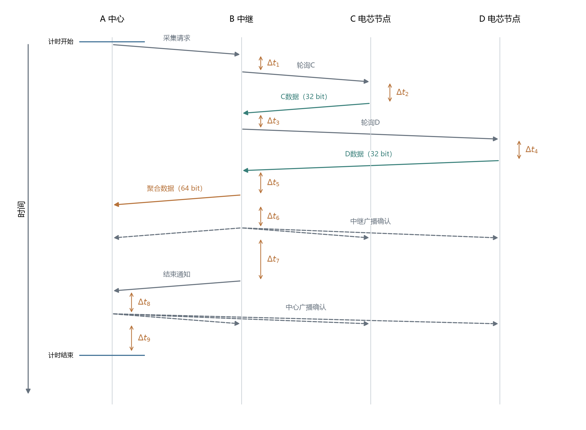
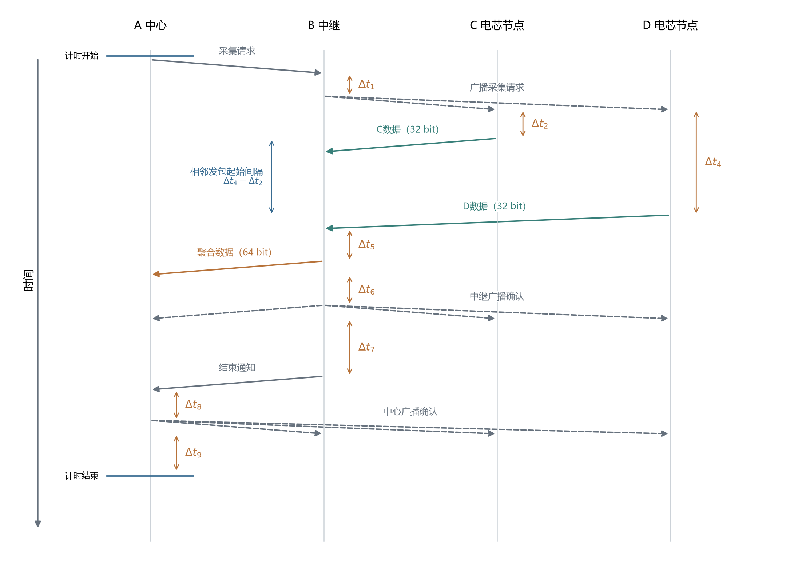
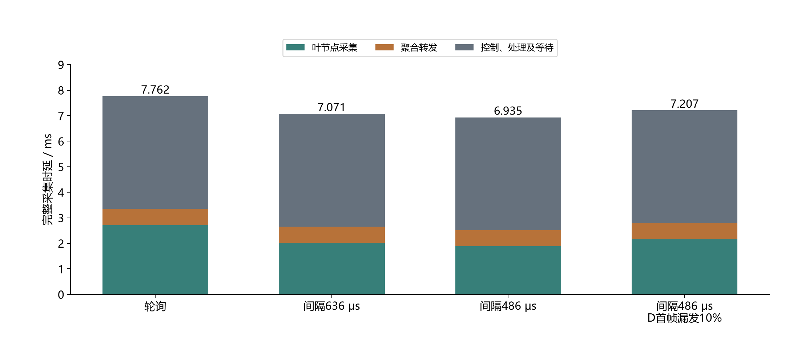
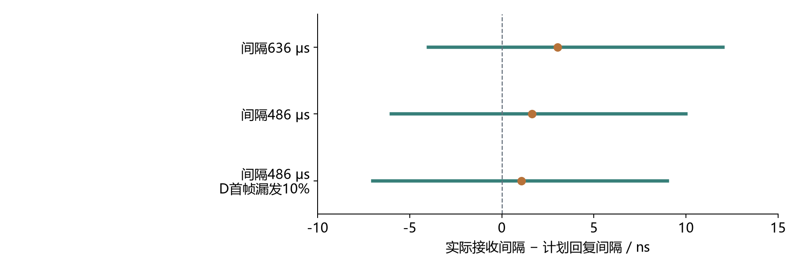

# 树型拓扑两跳中继：广播定时回复与轮询对照

## 实验参数设置

| 参数 | 设置 |
|---|---|
| 拓扑 | 树型拓扑两跳中继：A中心、B中继、C和D电芯节点 |
| 每条电芯数据 | 32 bit，由叶节点程序生成 |
| 每组数据量 | 50000条，两个电芯节点各25000条 |
| 信道、速率 | 信道5、6.8 Mbps |
| 数据帧长度 | 单条272 bit，聚合两条304 bit |
| 每个叶节点最多发送次数 | 5次，含首次发送 |
| 完整计时范围 | 中心发起采集前，到中心完成确认及确认后等待结束 |
| 中继转发前等待 | 200 μs，实验程序设置 |
| 确认前、后等待 | 200、500 μs，实验程序设置 |
| 结束通知前等待 | 1000 μs，实验程序设置 |

中继转发从电芯节点实际接收到的数据，中心核对来源、轮次与内容。

前导码长度64 symbol，首个叶节点计划回复延迟750 μs，广播相邻发包起始间隔取636或486 μs。计划回复延迟从请求帧的接收时间戳计算到回复帧的计划发送时间戳。

## 实验目的与流程

- **树型拓扑两跳中继采用广播定时回复，可减少一次请求帧。**
- **实验目的：把电芯节点到中继的采集、中继到中心的转发全部计入，测量广播调度能节省多少时间。** A为中心，B为中继，C、D为两个电芯节点；每组50000条数据。
- **轮询每轮发送九帧，广播定时回复每轮发送八帧。** 广播同时通知两个叶节点准备数据，替代两次独立轮询；缺失数据仍通过轮询重传。

图1. 树型拓扑两跳中继采用轮询时的完整流程，无重传时共九帧。时间向下，斜箭头从开始发送指向完整接收；一次广播由多条虚线箭头表示。纵向间距为示意。Δt₁为B收到采集请求到发送轮询C的处理时间；Δt₂、Δt₄分别为C、D完整接收轮询到开始发送数据的处理与等待时间；Δt₃为B收到C数据到轮询D的处理时间；Δt₅为B收到D数据到开始发送聚合帧，含200 μs等待；Δt₆为聚合帧发送完成到中继确认开始，含200 μs等待；Δt₇为中继确认发送完成到结束通知开始，含500 μs和1000 μs两项等待；Δt₈为中心收到结束通知到发送确认，含200 μs等待；Δt₉为中心确认发送完成到计时结束，含500 μs等待。各Δt均包含相应程序处理。

图2. 树型拓扑两跳中继采用广播定时回复时的完整流程，无重传时共八帧。Δt₁为B收到采集请求到发送广播请求；Δt₂、Δt₄分别为C、D完整接收广播到开始回复的处理与等待时间，D按计划晚于C回复。Δt₅～Δt₉与图1定义相同；省去第二次轮询及其前置处理Δt₃。斜箭头、广播虚线和计时范围与图1一致，纵向间距为示意。参数表中的750 μs以帧内硬件时间戳为起止，图中Δt以完整接收和开始发送为起止。Δt₄−Δt₂表示两个叶节点回复开始时刻之差，对应相邻发包起始间隔；图示以广播接收作为共同时间参考。

## 实验结果：完整采集时延降低10.7%

- **广播定时回复比轮询更高效；486 μs间隔下，平均6.935 ms收集两个电芯的数据。** 轮询为7.762 ms，每轮减少0.827 ms。
- **主要收益来自叶节点数据采集阶段。** 该阶段由2.711 ms降至1.882 ms；聚合转发约0.635 ms。
- **其他控制、处理和等待占63.7%，是当前最大开销。** 包括中心采集请求、中继与中心确认、结束通知及相应处理和等待。

图3. 树型拓扑两跳中继的实测完整采集时延。后三组采用广播定时回复；图中间隔为相邻数据帧开始时刻之差。每组50000条电芯数据、25000轮。绿色为B准备轮询或广播请求起，到两个叶节点的数据处理完成止，含重传；橙色为B准备聚合帧起，到发送完成止，含200 μs等待；灰色为中心完整计时减去前两项，涵盖其余控制帧、处理和等待。柱顶标注完整采集平均时延。前三组采用自然通信条件，第四组人为令D每十轮漏发一次首帧。

| 调度与设置 | 两个电芯平均采集时延（ms） | 首次缺失数据（条） | 最终收到/应收 |
|---|---:|---:|---:|
| 轮询 | 7.762 | — | 50000/50000 |
| 广播定时回复，间隔636 μs | 7.071 | 7 | 50000/50000 |
| 广播定时回复，间隔486 μs | 6.935 | 18 | 50000/50000 |
| 广播定时回复，间隔486 μs；D首帧漏发10% | 7.207 | 2510 | 50000/50000 |

轮询组记录重试次数，广播组另统计两个叶节点的首发缺失数量，表中“—”表示该项未单独记录。D首帧漏发10%对应2500次人为漏发，占全部50000条数据的5%；连同自然丢包共重传2510次，最终收齐。[数据来源](broadcast-tree-study/summary.json)。

## 实验结果：定时回复精度与接收处理时间

- **486 μs相邻发包起始间隔下，实测间隔偏差为−6～10 ns。** 统计24982轮两个首帧均收到的记录，未出现错过计划发送时刻。
- **中继处理一帧并恢复接收需要302～303 μs。** 486 μs相邻发包起始间隔对应约350 μs帧间隔，能够容纳本次处理过程；386 μs对应约250 μs，短测中第二帧需重传。

图4. 树型拓扑两跳中继采用广播定时回复时的相邻接收间隔偏差。图中间隔为计划的相邻回复开始时刻之差。横线为观察到的最小值至最大值，圆点为平均值。三组分别统计24993、24982、22491轮两个首帧均收到的记录。每轮广播重新提供时间参考；486 μs组的C、D计划回复时刻分别为广播接收时间戳之后750、1236 μs。

短测每档600条：386 μs间隔时首次收到300条；486、536、636 μs间隔时首次均收到600条。结合接收处理时间，本次缩短相邻发包起始间隔的主要约束来自中继读包、校验和重新开启接收。[原始记录](broadcast-tree-study/results.jsonl)。

## 结论

广播定时回复将完整采集时延由7.762 ms降至6.935 ms。下一步优化等待参数和控制流程，进一步降低采集时延。
