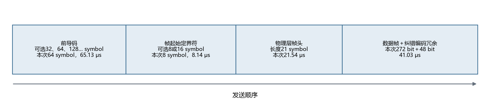
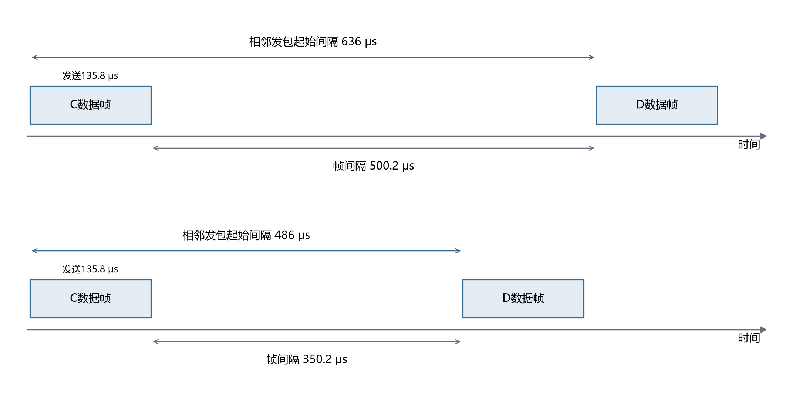
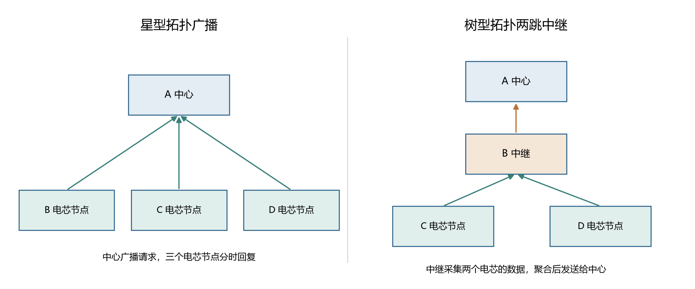
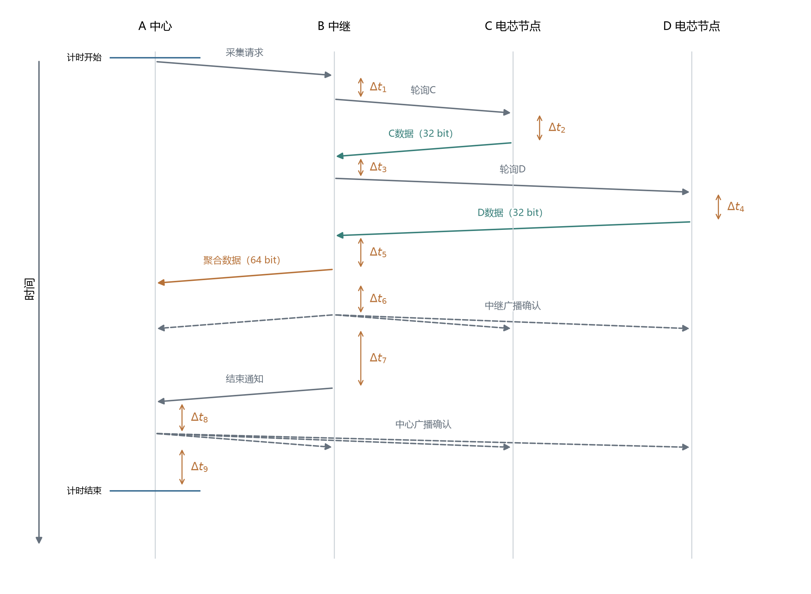
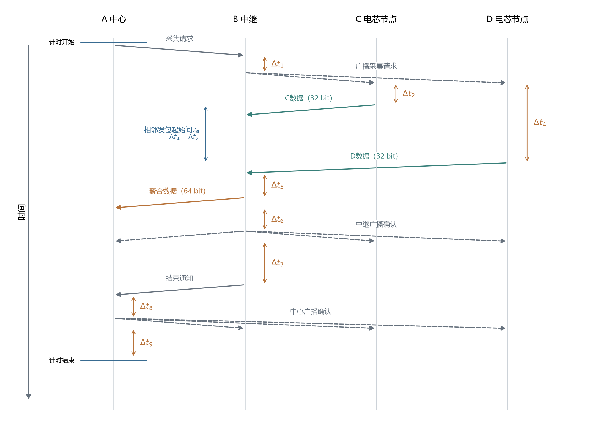
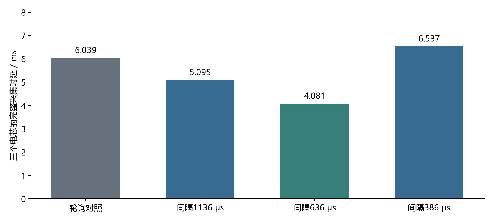
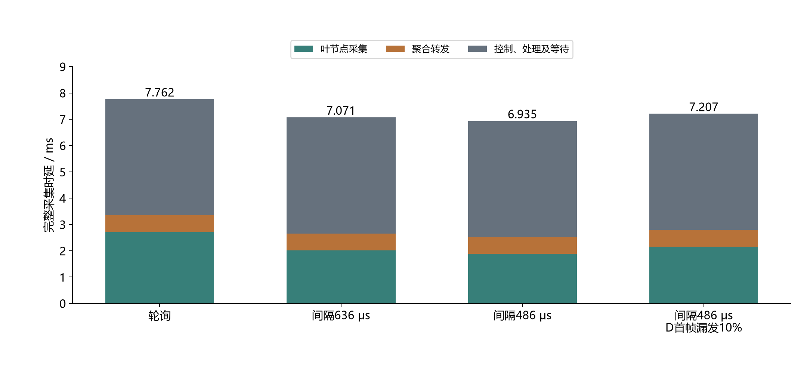
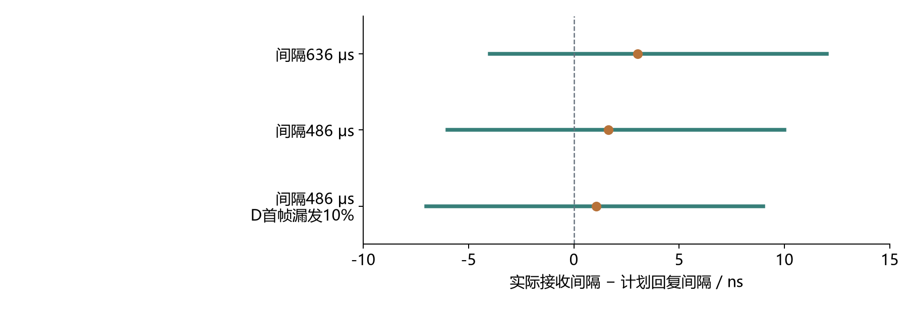

# 电芯UWB组网：广播调度、两跳中继与节点容量

## 1 研究目标与实验平台

- **已实现星型拓扑广播和树型拓扑两跳中继。** 基于[toolnail/UWB](https://github.com/toolnail/UWB)代码库，完成nRF52832、nRF52840主控适配及收发、复位、定时发送相关修改，实现广播请求、分时回复、缺包重传和中继聚合转发。
- **验证目标：200～300个电芯，每个电芯每100 ms上报32 bit数据。** 测量完整采集时延，判断现有流程能支持多少节点，以及主要优化空间在哪里。

实验使用四块UWB开发板。各电芯节点由程序生成带节点编号和轮次的测试数据，中继转发实际收到的数据，中心校验来源、轮次和内容。

## 2 帧结构与时间定义

### 2.1 现有结果对应的帧结构

- **电芯数据之外，每帧还包含同步、帧头和校验等开销。** 图1先给出所用物理层格式的字段顺序，图2再给出本实验的数据格式。

图1. DW3000所用数据帧模式的字段顺序、芯片支持的长度及本次取值。前导码与帧起始定界符的长度可配置；物理层帧头为21 symbol，其发送速率可配置；数据帧长度由应用决定，纠错编码由芯片生成。本次关闭安全时间戳序列，使用标称脉冲重复频率64 MHz、数据速率6.8 Mbps和标准物理层帧头速率。图中本次各部分时长合计约135.84 μs，宽度为示意。长度与时序依据[DW3000数据手册第4.4～4.5节](https://www.mouser.com/catalog/specsheets/Qorvo_DW3000.pdf)，可选配置依据[Qorvo驱动API指南的dwt_configure](https://forum.qorvo.com/uploads/short-url/xD3TlXKvkujjdUaJWXv2b4E7GQN.pdf)。

图2. 本实验单条数据帧的字段组成，共272 bit，其中电芯数据为32 bit；中继将两条电芯数据聚合后，数据帧为304 bit。152 bit实验管理字段由本实验程序自行添加；72 bit为标准短地址帧头，16 bit为芯片生成的校验。图中长度包括帧校验字段，前导码、物理层帧头及纠错编码冗余另计。字段宽度为示意，长度以标注为准。

**现有组网结果均采用272 bit单条数据帧、304 bit双条聚合帧，控制帧为240 bit。** 120 bit格式尚未进行重测。

**厂家定义编码格式和可选档位，实验程序选择具体参数。** 下表列明本次取值及修改权限。

| 项目 | 本次取值 | 能否修改、修改范围 | 来源 |
|---|---|---|---|
| 前导码长度 | 64 symbol，65.13 μs | 可配置，例如32、64、128、256、512、1024、1536、2048、4096 symbol | 芯片支持的长度档位，本实验选64 |
| 帧起始定界符 | Qorvo 8 symbol，8.14 μs | 可选择芯片支持的8或16 symbol序列格式 | 芯片配置项 |
| 物理层帧头 | 21 symbol，21.54 μs | 长度由所用格式定义；发送速率可选择标准速率或数据速率，时长随之变化 | 芯片编码格式及配置项 |
| 标准短地址帧头 | 72 bit | 沿用本次短地址格式时保持该长度；改变地址模式需同步修改协议 | IEEE 802.15.4格式，厂家示例采用 |
| 实验管理字段 | 152 bit | 可删除或重新设计；删除后的格式尚未实测 | 本实验自定义 |
| 电芯数据 | 每条32 bit | 应用可修改；本轮统一32 bit | 用户指定 |
| 帧校验 | 16 bit | 启用时长度固定；芯片提供关闭生成与校验的接口，本轮保留 | 芯片校验功能 |
| 纠错编码冗余 | 本次增加48 bit | 所用编码格式下，每个最多330 bit的数据块增加48 bit；由帧长自动决定 | 芯片编码规则 |

物理层字段、编码规则和时长依据[DW3000数据手册表18及第4.5节](https://www.mouser.com/catalog/specsheets/Qorvo_DW3000.pdf)；前导码、定界符、物理层帧头速率和校验开关依据[Qorvo驱动API指南](https://forum.qorvo.com/uploads/short-url/xD3TlXKvkujjdUaJWXv2b4E7GQN.pdf)。72 bit短地址帧头依据[Qorvo数据发送示例](https://github.com/toolnail/UWB/blob/main/DW3_QM33_SDK_1.1.1/Drivers/API/Src/examples/ex_07a_ack_data_tx/ack_data_tx.c)。

**前导码symbol表示一段已知脉冲序列；前导码长度表示该序列的重复次数。** 当前每个前导码symbol约1.01763 μs。按6.8 Mbps参考速率，可将其占用时间折算为等效bit数：

等效bit数 = 前导码长度 × 1.01763 μs/symbol × 6.8 bit/μs。

| 前导码长度 | 持续时间（μs） | 按6.8 Mbps折算的等效bit数 |
|---:|---:|---:|
| 32 symbol | 32.56 | 221.4 |
| 64 symbol | 65.13 | 442.9 |
| 128 symbol | 130.26 | 885.7 |

等效bit数表示相同发送时间在6.8 Mbps下对应的数据量，用于比较时间开销。前导码本身发送已知同步序列。数据字段长度统一标bit，前导码标symbol和μs。

### 2.2 单帧发送时间与帧间隔

- **单帧发送时间与帧间隔共同决定连续回复的速度。** 本实验前导码长度64 symbol时，272 bit数据帧的单帧无线发送时间约135.835 μs。

图3. 帧间隔与相邻发包起始间隔，横向按时间比例绘制。帧间隔从C帧结束计算到D帧开始；相邻发包起始间隔从C帧开始计算到D帧开始。272 bit数据帧在本次物理层配置下计算发送时长为135.835 μs；起始间隔636、486 μs分别对应帧间隔500.165、350.165 μs，图中保留一位小数。636、486 μs为程序设置，帧间隔为计算值。

前导码是同步序列，其长度使用芯片定义的符号数；电芯数据与数据帧长度统一使用bit。前导码长度128、64、32 symbol分别对应130.257、65.128、32.564 μs。

## 3 组网形式与实验方法

### 3.1 星型拓扑广播与树型拓扑两跳中继

- **星型拓扑广播：中心广播一次请求，三个电芯节点分时回复。** 数据直接到达中心；缺失数据由中心轮询重传。
- **树型拓扑两跳中继：两个电芯节点先发送给中继，中继聚合后发送给中心。** 比较中继逐节点轮询与广播定时回复两种调度方式。

图4. 两类拓扑的四板实现。左侧为星型拓扑广播，A为中心，B、C、D各提供32 bit电芯数据；右侧为树型拓扑两跳中继，A为中心，B为中继，C、D各提供32 bit电芯数据，B聚合为64 bit后转发。实线箭头表示数据流向，调度流程见图5、图6。

### 3.2 实验参数设置

| 参数 | 星型拓扑广播及其轮询对照 | 树型拓扑两跳中继 |
|---|---|---|
| 电芯数据量 | 每节点每轮32 bit | 每节点每轮32 bit |
| 每组测试数据量 | 100000条 | 50000条，两个叶节点各25000条 |
| 信道、数据速率 | 信道5、6.8 Mbps | 信道5、6.8 Mbps |
| 前导码长度 | 64 symbol | 64 symbol |
| 帧起始定界符长度 | 8 symbol | 8 symbol |
| 第一个电芯节点计划回复延迟 | 1000 μs | 750 μs |
| 广播后的相邻发包起始间隔 | 1136、636、386、236、186、136 μs | 正式测试636、486 μs |
| 单条数据帧长度 | 272 bit | 272 bit |
| 聚合数据帧长度 | — | 304 bit，含两条电芯数据 |
| 控制帧长度 | 240 bit | 240 bit |
| 每个电芯节点发送次数上限 | 5次，含首次发送 | 5次，含首次发送 |

数据量、回复延迟、相邻发包起始间隔和发送次数上限均为实验程序设置。计划回复延迟从请求帧的硬件接收时间戳计算到回复帧的计划发送时间戳；广播后各节点按编号依次增加一个相邻发包起始间隔。树型拓扑两跳中继采用486 μs间隔时，C、D的计划回复延迟分别为750、1236 μs。

| 树型拓扑两跳中继的等待参数 | 数值 | 设置位置 |
|---|---:|---|
| 中继转发前等待 | 200 μs | 聚合帧准备完成后、发送前 |
| 确认前等待 | 200 μs | 中继和中心各自发送确认前 |
| 确认后等待 | 500 μs | 中继和中心各自发送确认后 |
| 结束通知前等待 | 1000 μs | 中继发送结束通知前 |
| 中心接收结束通知的超时上限 | 60 ms | 接收到结束通知即退出等待 |

这些等待参数由实验程序设置，轮询与广播定时回复对照采用相同数值。

### 3.3 测量方法

- **完整采集时延：** 中心准备发起本轮采集开始，到接收本轮数据、完成确认及确认后等待结束；包含协议处理、重传和超时。
- **首次接收率：** 未重传时收到的数据条数除以应收条数。**最终接收率：** 包含重传后收到的数据条数除以应收条数。
- **相邻发包起始间隔偏差：** 中继测得的两帧接收时间戳之差，减去计划发包起始间隔。使用同一中继的硬件时钟统计。

每个实验条件单独统计。星型拓扑广播与树型拓扑两跳中继分别使用各自的轮询对照评价调度收益。

## 4 实验结果与分析

### 4.1 树型拓扑两跳中继：轮询与广播定时回复

- **树型拓扑两跳中继采用广播定时回复，可减少一次请求帧。**
- **实验目的：把电芯节点到中继的采集、中继到中心的转发全部计入，测量广播调度能节省多少时间。** A为中心，B为中继，C、D为两个电芯节点；每组50000条数据。
- **轮询每轮发送九帧，广播定时回复每轮发送八帧。** 广播同时通知两个叶节点准备数据，替代两次独立轮询；缺失数据仍通过轮询重传。

图5. 树型拓扑两跳中继采用轮询时的完整流程，无重传时共九帧。时间向下，斜箭头从开始发送指向完整接收；一次广播由多条虚线箭头表示。纵向间距为示意。Δt₁为B收到采集请求到发送轮询C的处理时间；Δt₂、Δt₄分别为C、D完整接收轮询到开始发送数据的处理与等待时间；Δt₃为B收到C数据到轮询D的处理时间；Δt₅为B收到D数据到开始发送聚合帧，含200 μs等待；Δt₆为聚合帧发送完成到中继确认开始，含200 μs等待；Δt₇为中继确认发送完成到结束通知开始，含500 μs和1000 μs两项等待；Δt₈为中心收到结束通知到发送确认，含200 μs等待；Δt₉为中心确认发送完成到计时结束，含500 μs等待。各Δt均包含相应程序处理。

图6. 树型拓扑两跳中继采用广播定时回复时的完整流程，无重传时共八帧。Δt₁为B收到采集请求到发送广播请求；Δt₂、Δt₄分别为C、D完整接收广播到开始回复的处理与等待时间，D按计划晚于C回复。Δt₅～Δt₉与图5定义相同；省去第二次轮询及其前置处理Δt₃。斜箭头、广播虚线和计时范围与图5一致，纵向间距为示意。参数表中的750 μs以帧内硬件时间戳为起止，图中Δt以完整接收和开始发送为起止。Δt₄−Δt₂表示两个叶节点回复开始时刻之差，对应相邻发包起始间隔；图示以广播接收作为共同时间参考。

### 4.2 星型拓扑广播：完整采集时延降低32.4%

- **星型拓扑广播比逐节点轮询更高效，完整采集时延降低32.4%。**
- **实验目的：验证一次广播能否减少逐节点轮询的控制开销，并确定可用的相邻发包起始间隔。** 使用一个中心、三个电芯节点；各节点每轮提供32 bit数据，每组测试100000条。
- **相邻发包起始间隔636 μs时，收集三个电芯的数据平均需4.081 ms。** 同一星型拓扑下的轮询对照为6.039 ms。
- **相邻发包起始间隔缩短到386 μs后，首次接收率下降，完整采集时延增加到6.537 ms。** 更短的计划间隔需要以接收方及时处理下一帧为前提。

图7. 星型拓扑广播与同一星型拓扑下轮询对照的完整采集时延，柱高为实测平均值。各组前导码长度64 symbol，首个节点计划回复延迟1000 μs，每节点每轮32 bit数据；每组100000条，包含重传和确认。展示1136、636、386 μs三档广播相邻发包起始间隔。

| 调度方式 | 相邻发包起始间隔（μs） | 首次接收率 | 三个电芯平均采集时延（ms） | 最终收到/应收 |
|---|---:|---:|---:|---:|
| 同一星型拓扑下的轮询对照 | 由逐次请求决定 | 99.874% | 6.039 | 100000/100000 |
| 星型拓扑广播 | 1136 | 99.883% | 5.095 | 100000/100000 |
| 星型拓扑广播 | 636 | 99.899% | 4.081 | 100000/100000 |
| 星型拓扑广播 | 386 | 66.570% | 6.537 | 100000/100000 |

广播减少了逐节点请求的帧数。636 μs为本次星型拓扑广播扫描中完整采集时延最小的设置。[数据来源](four-board-study/formal-summary.json)。

### 4.3 树型拓扑两跳中继：广播调度降低10.7%的完整采集时延

- **广播定时回复比轮询更高效；486 μs间隔下，平均6.935 ms收集两个电芯的数据。** 轮询为7.762 ms，每轮减少0.827 ms。
- **主要收益来自叶节点数据采集阶段。** 该阶段由2.711 ms降至1.882 ms；聚合转发约0.635 ms。
- **其他控制、处理和等待占63.7%，是当前最大开销。** 包括中心采集请求、中继与中心确认、结束通知及相应处理和等待。

图8. 树型拓扑两跳中继的实测完整采集时延。后三组采用广播定时回复；图中间隔为相邻数据帧开始时刻之差。每组50000条电芯数据、25000轮。绿色为B准备轮询或广播请求起，到两个叶节点的数据处理完成止，含重传；橙色为B准备聚合帧起，到发送完成止，含200 μs等待；灰色为中心完整计时减去前两项，涵盖其余控制帧、处理和等待。柱顶标注完整采集平均时延。前三组采用自然通信条件，第四组人为令D每十轮漏发一次首帧。

| 调度与设置 | 两个电芯平均采集时延（ms） | 首次缺失数据（条） | 最终收到/应收 |
|---|---:|---:|---:|
| 轮询 | 7.762 | — | 50000/50000 |
| 广播定时回复，间隔636 μs | 7.071 | 7 | 50000/50000 |
| 广播定时回复，间隔486 μs | 6.935 | 18 | 50000/50000 |
| 广播定时回复，间隔486 μs；D首帧漏发10% | 7.207 | 2510 | 50000/50000 |

轮询组记录重试次数，广播组另统计两个叶节点的首发缺失数量，表中“—”表示该项未单独记录。D首帧漏发10%对应2500次人为漏发，占全部50000条数据的5%；连同自然丢包共重传2510次，最终收齐。[数据来源](broadcast-tree-study/summary.json)。

### 4.4 定时回复精度与接收处理时间

- **486 μs相邻发包起始间隔下，实测间隔偏差为−6～10 ns。** 统计24982轮两个首帧均收到的记录，未出现错过计划发送时刻。
- **中继处理一帧并恢复接收需要302～303 μs。** 486 μs相邻发包起始间隔对应约350 μs帧间隔，能够容纳本次处理过程；386 μs对应约250 μs，短测中第二帧需重传。

图9. 树型拓扑两跳中继采用广播定时回复时的相邻接收间隔偏差。图中间隔为计划的相邻回复开始时刻之差。横线为观察到的最小值至最大值，圆点为平均值。三组分别统计24993、24982、22491轮两个首帧均收到的记录。每轮广播重新提供时间参考；486 μs组的C、D计划回复时刻分别为广播接收时间戳之后750、1236 μs。

短测每档600条：386 μs间隔时首次收到300条；486、536、636 μs间隔时首次均收到600条。结合接收处理时间，本次缩短相邻发包起始间隔的主要约束来自中继读包、校验和重新开启接收。[原始记录](broadcast-tree-study/results.jsonl)。

## 5 100 ms内能收齐多少节点

- **相邻发包起始间隔决定连续回复速度，完整采集时延决定一轮能收齐多少节点。** 广播请求、重传、中继转发、确认及等待均需计入总时间。

### 5.1 先用帧间隔计算连续回复的时间预算

相邻发包起始间隔 S = 单帧发送时间 T + 帧间隔 G。

按每节点分配一个完整时槽计算，连续回复的预算容量为 floor(100000 / S)，其中时间单位为μs。floor表示向下取整。

| 相邻发包起始间隔S | 单帧发送时间T | 帧间隔G | 100 ms可分配的连续回复时槽 |
|---:|---:|---:|---:|
| 636 μs | 135.835 μs | 500.165 μs | 157 |
| 486 μs | 135.835 μs | 350.165 μs | 205 |

**157和205表示只安排连续数据回复时的时槽数量。** 要得到中心完整收齐的节点数，还要给广播、补发、中继转发和确认留出时间。若300节点共用100 ms，每节点的全部通信预算约333.3 μs。

### 5.2 再按实测完整流程计算节点容量

**按现有流程串行重复，星型拓扑广播在100 ms平均时间预算内可安排72节点；树型拓扑两跳中继可安排28节点。**

每组电芯数记为k，每组实测平均完整采集时延记为R（ms）。各组在同一信道依次执行相同流程：

- 100 ms容量 = k × floor(100 / R)。
- N节点采集时间 = ceil(N / k) × R；ceil表示向上取整，最后一组按完整一轮计时。

| 拓扑与调度 | 每组电芯数k | 实测平均完整时延R（ms） | 100 ms容量（节点） | 200节点推算（ms） | 300节点推算（ms） |
|---|---:|---:|---:|---:|---:|
| 星型拓扑广播：轮询对照 | 3 | 6.039 | 48 | 404.6 | 603.9 |
| 星型拓扑广播：间隔636 μs | 3 | 4.081 | 72 | 273.4 | 408.1 |
| 树型拓扑两跳中继：轮询 | 2 | 7.762 | 24 | 776.2 | 1164.3 |
| 树型拓扑两跳中继：间隔636 μs | 2 | 7.071 | 28 | 707.1 | 1060.7 |
| 树型拓扑两跳中继：间隔486 μs | 2 | 6.935 | 28 | 693.5 | 1040.2 |

表中R来自四块板的实测，包含控制、数据、重传、处理和等待；容量及200、300节点耗时为相同小分组串行重复的推算。实际测试规模为星型三个电芯节点、树型两个电芯节点。上述容量按平均耗时计算，截止时间内的成功率需进一步测试。

### 5.3 删除152 bit实验管理字段后的性能推算

**单条数据帧可由272 bit缩短到120 bit，计算发送时间减少19.488 μs，约14.3%。删除后的格式尚未实测。** 下表保留前导码长度64 symbol、8 symbol定界符、标准速率物理层帧头及原数据速率。

| 项目 | 现有格式 | 删除字段后的格式 | 数据性质 |
|---|---:|---:|---|
| 单条数据帧长度 | 272 bit | 120 bit | 现有程序格式／拟采用格式 |
| 单条数据帧无线发送时间 | 135.835 μs | 116.347 μs | 均按厂家物理层时序计算 |
| 两条数据聚合帧长度 | 304 bit | 152 bit | 现有程序格式／拟采用格式 |
| 两条数据聚合帧无线发送时间 | 139.938 μs | 120.450 μs | 均按厂家物理层时序计算 |

两种帧缩短前后均落在单个纠错编码块内，附加48 bit纠错冗余。因此每帧节省时间为152 × 0.12821 μs = 19.488 μs。[计算依据：DW3000数据手册表18与第4.5节](https://www.mouser.com/catalog/specsheets/Qorvo_DW3000.pdf)。上述单帧时长属于计算值，完整采集时延属于硬件实测值。

**保持帧间隔不变，同时缩短相邻发包起始间隔，100 ms的连续回复时槽预算可由157增加到162，或由205增加到214。**

| 保持不变的帧间隔G | 现有起始间隔S | 删除字段后的起始间隔S′ | 现有时槽预算 | 删除字段后的时槽预算 |
|---:|---:|---:|---:|---:|
| 500.165 μs | 636 μs | 616.512 μs | 157 | 162 |
| 350.165 μs | 486 μs | 466.512 μs | 205 | 214 |

计算采用S′ = S − 19.488 μs、时槽预算 = floor(100000 / S′)。整张表均为推算，仅分配连续数据回复时槽；完整流程还需计入广播、补发、中继转发和确认。若程序继续使用636或486 μs起始间隔，连续回复时槽预算仍为157或205。

**按现有小分组完整流程估计，仅缩短数据帧仍不足以支持200～300节点在100 ms内完成采集。** 进一步作如下时间预算：删除叶节点数据帧及聚合帧中的152 bit字段，同时将广播后的起始间隔缩短19.488 μs；首个节点回复延迟、控制帧、处理和等待按现有值保留。

星型一轮三个数据帧；树型一轮两个叶节点数据帧和一个聚合帧。正常轮次的数据发送总时长均减少约58.464 μs。以下以实测平均完整时延扣除这部分时间估计，额外重传帧的缩短收益暂按零计入。

| 拓扑与现有设置 | 现有平均完整时延：实测（ms） | 精简后完整时延：推算（ms） | 100 ms容量：现有→精简后，均为推算 | 精简后200／300节点耗时：推算（ms） |
|---|---:|---:|---:|---:|
| 星型拓扑广播，636 μs | 4.081 | 4.022 | 72 → 72 | 269.5／402.2 |
| 树型拓扑两跳中继，636 μs | 7.071 | 7.013 | 28 → 28 | 701.3／1051.9 |
| 树型拓扑两跳中继，486 μs | 6.935 | 6.876 | 28 → 28 | 687.6／1031.4 |

容量继续采用第5.2节的小分组串行公式。推算中100 ms可容纳的完整分组数保持相同，因此节点容量仍为72或28。删除字段、缩短起始间隔以及处理耗时的实际变化，需在后续实验验证。

58.464 μs表示三帧无线发送时间之和的缩短量；表中的完整流程收益还以同步缩短相邻发包起始间隔为条件。

### 5.4 结论

- **广播定时回复提高了采集效率。** 星型拓扑广播比轮询降低32.4%的完整采集时延；树型拓扑两跳中继在636 μs起始间隔下降低8.9%，486 μs下降低10.7%。
- **现有小分组串行流程超出200～300节点、100 ms的时间预算。** 树型拓扑两跳中继的主要开销是控制、处理与等待；仅缩短叶节点相邻发包起始间隔，收益有限。
- **下一步统一采用120 bit常规短地址数据帧重测，并扩大单次广播的调度节点数。** 120 bit由72 bit短地址帧头、32 bit电芯数据和16 bit校验组成；第5.2节容量推算对应现有272 bit单条数据帧；第5.3节单列删除字段后的性能推算。
