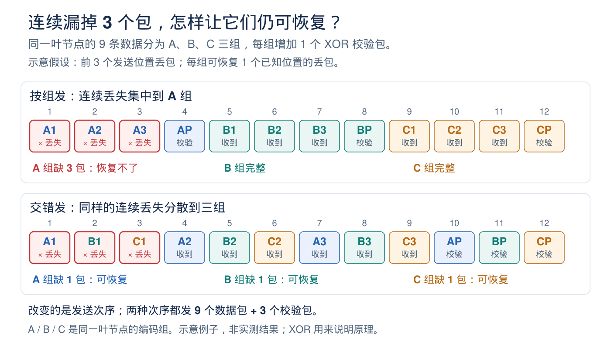
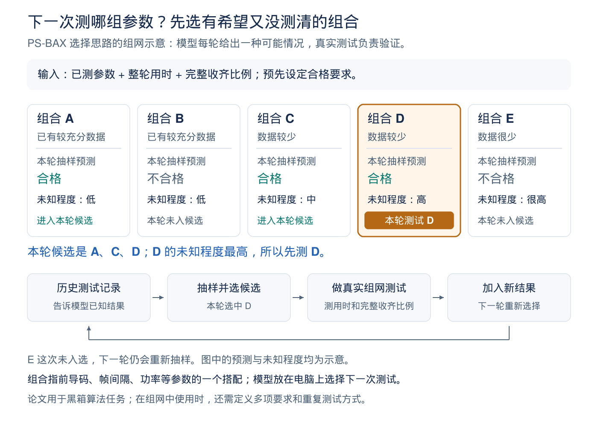

# 电芯 UWB 组网的三个论文思路图解

这三种办法分别处理连续丢包、遮挡后的补发和部署时的参数选择。应用背景是中心节点在 100 ms 内收齐一轮电芯数据；现有原型由 1 个中心和 7 个叶节点承担每轮 300 条记录。下面用少量数据包把动作画出来，讨论它们能怎样接到这项工作上。

三张图均为原创示意。包编号、丢包位置和参数候选用于解释原理；对应的 UWB 方案仍是待验证的研究设想。本文整理已读论文的应用思路，不增加论文研读篇数。

| 遇到的问题 | 这项办法改了什么 | 配套工具 |
| --- | --- | --- |
| 一小段时间内连续漏包，需要反复补发 | 改变数据排列，让连续丢失分到不同编码组 | 逐包接收记录、XOR 校验、Python 日志分析 |
| 某个叶节点被遮挡，向中心重复发送仍容易失败 | 让另一位置收到的副本补上中心缺的数据 | 辅助接收点、包编号、缺包位图、缓存与转发 |
| 换了安装位置，又要测试许多参数组合 | 用已有测量决定下一次最该测哪组参数 | PS-BAX、电脑上的概率模型、现有测试脚本 |

## 一 连丢三个包时 怎样让校验仍然够用

### 先看数据怎样丢

一种直接做法是按顺序发送，中心统计缺包，再通知源节点补发。考虑一个叶节点已经缓存了 9 条数据，把它们分为 A、B、C 三组，每组 3 条。每组再算出 1 条校验数据，便得到 12 个待发送包。

这里的校验采用逐位异或，简称 XOR。它提供一个可倒推的关系：收到 A2、A3 和 AP，就能算回缺失的 A1。每组只能恢复一个已知位置的丢包；丢掉两个数据包时，一份校验就不够了。CRC 与预定包编号共同帮助接收端识别哪些位置没有收到有效数据。

图 1：两种排法都发送 9 条数据和 3 条校验，也都丢掉前三个发送位置。A、B、C 是同一叶节点缓存中的编码组。

上排先把 A 组发完，再发 B、C。前三个包一丢，A 组只剩校验，无法还原三条数据。下排轮流发送 A、B、C，同一段干扰各拿走一组中的一个包；每组剩下的三个包足以恢复。这种轮流排列叫交织。

**这个思路巧在改变丢包落在哪一组：连续丢三包，经过重排变成三次各丢一包，正好进入每组校验的恢复能力。**

### 放进当前组网可以做什么

它适合研究“缩短单包时间后，少量校验能否减少补发等待”。先检查短前导码等对照中的漏包是否连续发生，再用同一份日志比较连续排法和交织排法可恢复多少条。第一版可以只在一个叶节点已经缓存的数据内重排，无需让不同叶节点共享数据来生成校验。

这个例子比单发 9 个数据包多了 3 个校验包，发送量增加三分之一。某组数据等校验到达的时间也会改变。因此比较时要把首发、校验、反馈和补发都计入整轮时间。当前稳定配置可以作为基线，待验证的收益是新条件下能否更快收齐。

配套工具很轻：Python 读取每轮、叶节点、包编号和接收结果，尝试重排；XOR 负责恢复示例中的单个缺包。日志重排能检查这种丢失形状是否适合编码，实际发送顺序改变后的效果再由真机对照确认。

### 论文提供了哪部分启发

MeAnt 使用 Polar 编码与交织矩阵保护跨介质传输，再比较不同接入条件下的编码率。上面的 XOR 是为解释交织而自拟的简化例子。这里借用的是“观察剩余损失怎样分布，再选择冗余与排列”的设计思路。[MeAnt，MobiCom 2024，§3.3、§5.4](https://web.comp.polyu.edu.hk/csyanglei/data/files/MeAnt-mobicom24.pdf) · [详细研读笔记](2026-11-18-continue-31.md#meant)

## 二 两个接收点都收到九成 为什么有时能补齐

### 先看漏掉的是不是同一个包

在星型网络中，某个叶节点的包没有到达中心，直接做法是让该叶节点再发一次。若遮挡持续存在，下一次仍经过同一条受影响路径。现在增加一个辅助接收点，让它监听相同的发送。

只看“中心和辅助各收到 90%”，还不知道它能帮上多少忙。图 2 用 10 个包说明两种情况。

图 2：两个接收点的单独接收率始终是 9/10。左侧的缺失完全重合；右侧的缺失可以互补。“合并”表示两处缓存共同拥有的数据，送到中心还需要转发。

左边两处都没有第 4 包，增加辅助接收点仍补不回来。右边辅助有第 4 包，中心有第 7 包，两处合起来刚好齐全。此时只需让辅助把第 4 包转给中心。

**辅助接收点的价值在于：中心漏掉的那个包，它恰好收到了。选择辅助位置时，应看它补回了哪些缺口。**

### 放进当前组网可以做什么

它对应模组外壳、天线安装位置造成的局部遮挡。第一步可以让一个源节点同时被中心和辅助监听，按同一包编号对齐结果，统计“中心没收到、辅助收到”的次数。这样能先判断某个辅助位置有没有补漏机会。

随后才需要缓存和转发协议：中心在首发后给出缺包位图，辅助只转发自己缓存中与缺包位图相交的记录。包身份可由轮次、源节点和记录序号共同确定，避免旧数据或其他节点的数据被误当成补齐。

辅助监听会增加接收能耗，转发会占用时隙。若目标是省去源节点的一次补发，辅助须及时补齐数据，让中心能在源节点再次发出该包前取消对应补发。因此最直接的比较是：同一批缺包，用源节点补发和辅助转发，分别需要多久收齐、增加多少发送。单独提高联合覆盖率，还需要通过这一步变成中心收到的数据。

### 论文提供了哪部分启发

SateRIoT 让地面网关共享缓存，利用不同网关的卫星上行机会，并用计划与完成通知减少重复发送。这里将“利用不同位置的机会，并及时协调副本”迁移为 UWB 辅助接收设想；图 2 的 10 包例子为原创。论文的 LoRa 泛洪流程及秒级时延需要按 UWB 的时隙重新设计。[SateRIoT，MobiCom 2024，§3.3、§5.3](https://cse.msu.edu/~caozc/papers/mobicom24-ren-sateriot.pdf) · [详细研读笔记](2026-11-18-continue-32.md#sateriot)

## 三 参数太多时 下一次为什么测 D

### 先把要找的答案说清楚

换一个安装位置，可能需要重新选前导码长度、帧间隔和发射功率。逐个组合测试容易操作，组合一多就耗时。可以先把任务定为：找出一批满足时限与完整率要求的设置，供不同安装条件选用。

PS-BAX 提供了一种选择下一次测量的办法。电脑保存已经测过的参数及结果，建立一个模型。模型同时表示每组参数可能表现如何，以及这个判断还有多大不确定性。这里的“不确定”指模型对结果还拿不准。

图 3：A–E 是五组抽象参数，未指定硬件数值。“预测合格”来自这一次模型抽样，真实测试完成后才增加测量依据。

这一轮的动作可以逐步读：

1. 根据已有测量，模型抽出一张可能的完整结果表。它把 A、C、D 列为可能合格的配置。
2. A 已有较充分的数据，C 还有些拿不准，D 最拿不准。因此在这三个候选中选 D。
3. 测试脚本在真实组网上运行 D，记录完成时间和按时收齐的比例，再用测量结果更新模型。
4. 下一轮重新抽样、重新选择。E 本轮未入选，以后仍可能进入候选。

**这个思路把一次测试留给“可能进入可用名单、又没测清楚”的配置。它让当前要找的答案参与决定下一次测什么。**

### 放进当前组网可以做什么

它可以帮助完成新安装位置的参数标定：保留现有稳定配置，再找出哪些更短、更省发送时间的设置也满足要求。输出是一张带测量依据的可用配置表，后续可按安装条件查用。

起步时可以固定功率与摆位，只搜索固件支持的前导码和帧间隔组合。电脑上的模型负责推荐下一组，现有测试脚本负责实际测量，单片机继续执行通信。模型的判断应对应整轮业务结果；接收功率可作为辅助信息。

若把时限和完整率同时作为条件，需要为这两个测量结果建立模型，并明确怎样共同判定合格。这是将论文方法接入组网任务时的新增设计。先在小参数表上用充分重复测量得到参考答案，再比较逐项扫描、随机选择和模型选点：在相同测试次数下，各自找对多少可用设置，误选多少、漏掉多少。选出的配置再用独立轮次确认。

### 可以直接查看的工具

[PS-BAX 作者代码](https://github.com/RaulAstudillo06/PSBAX)提供 `demos/level-set.py`，演示找出超过预设门限的点。论文规则是先对函数做后验抽样，执行目标算法得到候选集合，再在集合内选择不确定性最大的点测量；它适合这里“找出合格配置集合”的任务表述。图 3 将这一轮选择过程画成参数卡片。[PS-BAX，NeurIPS 2024，§3、Algorithm 1、§4.2](https://proceedings.neurips.cc/paper_files/paper/2024/file/f3c8bfcc9c2bc13a0f141cb58afc6e5a-Paper-Conference.pdf) · [详细研读笔记](2026-11-18-continue-32.md#ps-bax)

## 怎样接到后续实验和论文里

先做参数选择最容易接上现有测试流程。交织需要先看到有规律的连续缺包；辅助接收需要先看到不同位置的接收结果互补。三种方案的第一项检查各不相同，检查结果决定后续投入。

| 思路 | 先看什么现象 | 论文里怎样把理由讲清楚 |
| --- | --- | --- |
| 交织与校验 | 同样丢包数，集中在一个编码组和分散到多组时，恢复结果是否不同 | 先给丢失位置图，再解释排列怎样改变每组损失，最后比较包含冗余与补发的整轮时间 |
| 辅助接收 | 中心失败的同一包，辅助是否成功 | 先给逐包配对图，再展示补漏动作，最后统计中心按时收齐的收益和转发开销 |
| 模型选点 | 一次新测量能否帮助确定可用配置 | 先定义合格条件，再画一次选择和更新过程，最后比较同样测试次数下的误选、漏选与测试总时间 |

以后让 AI 阅读这份笔记时，可以沿着这三个例子组织论证：先让读者看到一个具体失败或选择困难，再指出哪个可改变的量影响结果，随后说明方法怎样改变它。示意图用于解释动作，真实实验图用于报告效果；把两者各自的任务写在引图句和图注里。这里的数值例子保留为解释素材，写入实验结果的数值来自对应测量。

图的可编辑 SVG 与生成脚本保存在[配图目录](assets/2026-11-18-network-insights/)。返回[论文研读索引](README.md)。
